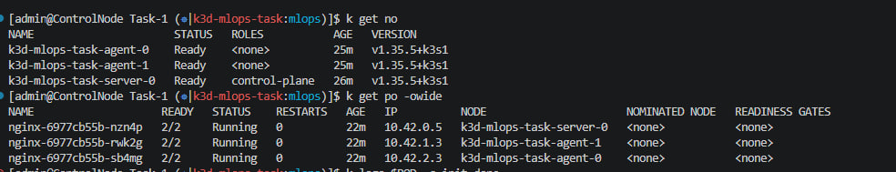
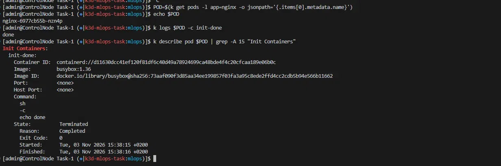
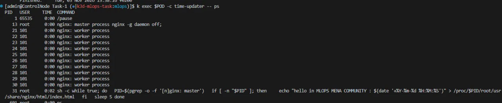
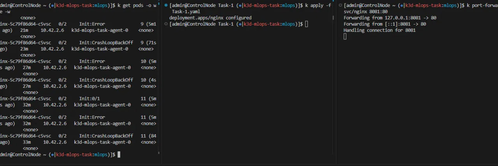
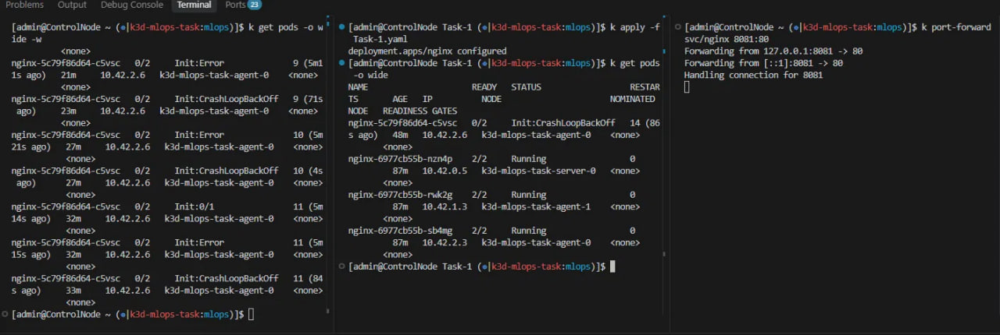

# Task 1 — Multi-Container Pods (Init Container & Sidecar)

An Nginx "Hello" page that shows the current timestamp, refreshed every 5 seconds:

```text
hello in MLOPS MENA COMMUNITY : 2026-11-03 15:40:05
```

Deployed as 3 replicas on a 3-node cluster, using an init container, a main container and a sidecar that share a process namespace, with **no volumes**.

> **Cluster note:** The task specifies Minikube. This was run on **k3d** (k3s in Docker) with 1 server + 2 agents, which gives the same 3-node setup. The manifest works unchanged on Minikube (`minikube start --nodes 3`).

---

## Pod Architecture

| Container | Type | Image | Role |
|---|---|---|---|
| `init-done` | Init | `busybox:1.36` | Prints `done` and exits 0. The other containers start only if it succeeds. |
| `nginx` | Main | `nginx` | Writes the first `index.html` with the current timestamp, then serves it on port 80. |
| `time-updater` | Sidecar | `busybox:1.36` | Every 5s rewrites `index.html` with the current timestamp through `/proc/<pid>/root`. |

### How the sidecar writes into nginx without a volume

`shareProcessNamespace: true` puts all containers of the Pod in one PID namespace, so the sidecar can see nginx's processes. On Linux, `/proc/<pid>/root` points to that process's root filesystem. The sidecar finds the nginx master PID and writes to:

```text
/proc/<nginx-pid>/root/usr/share/nginx/html/index.html
```

which is the exact file nginx serves.

```sh
while true; do
  PID=$(pgrep -o -f '[n]ginx: master')     # [n] stops pgrep matching this script itself
  if [ -n "$PID" ]; then
    echo "hello in MLOPS MENA COMMUNITY : $(date '+%Y-%m-%d %H:%M:%S')" \
      > /proc/$PID/root/usr/share/nginx/html/index.html
  fi
  sleep 5
done
```

### Zero-downtime settings

| Setting | Value | Why |
|---|---|---|
| `replicas` | `3` | One Pod per node |
| `maxUnavailable` | `0` | A running Pod is never removed until its replacement is Ready |
| `maxSurge` | `1` | Only one new Pod is tried at a time, so a bad change affects one Pod only |
| `topologySpreadConstraints` | by hostname | Spreads the Pods across the 3 nodes |

---

## Files

```text
Task-1/
├── Task-1.yaml        # Deployment (namespace: mlops)
├── README.md
└── screenshots/
```

---

## Deploy

```bash
k3d cluster create mlops-task --servers 1 --agents 2
kubectl create namespace mlops
kubectl config set-context --current --namespace mlops

kubectl apply -f Task-1.yaml
kubectl expose deployment nginx --port 80
```

### Nodes and running Pods

Three nodes `Ready`, and three Pods `2/2 Running`, one on each node. `READY 2/2` counts the two long-running containers; the init container has already completed.



---

## Verification Checks

```bash
POD=$(kubectl get pods -l app=nginx -o jsonpath='{.items[0].metadata.name}')
```

### 1. Init container succeeded

```bash
kubectl logs $POD -c init-done
kubectl describe pod $POD | grep -A 15 "Init Containers"
```

The log prints `done`, and the container is `Terminated` with `Reason: Completed` and `Exit Code: 0`.



### 2. Shared process namespace

```bash
kubectl exec $POD -c time-updater -- ps
```

Running `ps` from inside the sidecar shows the processes of the other containers:

| PID | Process | Belongs to |
|---|---|---|
| 1 | `/pause` | Pod infrastructure container |
| 13 | `nginx: master process` | `nginx` container (the PID the sidecar targets) |
| 21–30 | `nginx: worker process` | `nginx` container |
| 31 | `sh -c while true ...` | `time-updater` script |

PID 31's command line contains the word "nginx", but `pgrep '[n]ginx: master'` does not match it, so the sidecar always picks PID 13.



### 3. Timestamp updates every 5 seconds

```bash
for i in 1 2 3; do kubectl exec $POD -c time-updater -- wget -qO- localhost; sleep 6; done
```

```text
hello in MLOPS MENA COMMUNITY : 2026-11-03 15:40:05
hello in MLOPS MENA COMMUNITY : 2026-11-03 15:40:11
hello in MLOPS MENA COMMUNITY : 2026-11-03 15:40:16
```

### 4. Page through the Service

```bash
kubectl port-forward svc/nginx 8081:80
curl localhost:8081
```

---

## Failure Experiment: `init-done` exits 1

### Break it

In `Task-1.yaml`, change the init command:

```yaml
command: ["sh", "-c", "echo done"]          # before
command: ["sh", "-c", "echo fail; exit 1"]  # after
```

```bash
kubectl apply -f Task-1.yaml
kubectl get pods -o wide -w
```

### Init:CrashLoopBackOff

1. Changing the Pod template starts a rollout and creates a new ReplicaSet.
2. Because `maxSurge: 1`, only **one** new Pod is created.
3. Its `init-done` container exits with code 1, so the Pod shows `Init:Error`.
4. The kubelet retries with an increasing delay (10s, 20s, 40s … up to 5 min), so the status alternates between `Init:Error` and `Init:CrashLoopBackOff` while the restart count keeps growing.
5. `nginx` and `time-updater` **never start** in that Pod, because all init containers must succeed first. The Pod stays at `0/2`.



### Zero downtime

While the new Pod is crash-looping (14 restarts), the 3 old Pods are still `2/2 Running` on all 3 nodes, and the Service keeps serving traffic through the port-forward.

This is because the new Pod never becomes Ready, and `maxUnavailable: 0` forbids removing a Ready Pod before its replacement is Ready. The rollout simply stalls and the old ReplicaSet keeps all 3 Pods.



### Diagnosis

```bash
BAD=<failing-pod-name>
kubectl describe pod $BAD | grep -A 20 "Init Containers"
kubectl logs $BAD -c init-done --previous
kubectl get rs
kubectl rollout status deploy nginx --timeout=10s
```

| Check | Result |
|---|---|
| `describe` | `State: Waiting`, `Reason: CrashLoopBackOff`, `Last State: Terminated`, `Exit Code: 1`, and a `BackOff` event |
| `logs --previous` | `fail` |
| `get rs` | Old ReplicaSet 3/3 Ready, new ReplicaSet 0 Ready |
| `rollout status` | Never completes |

---

## Recovery

Restore `echo done` in `Task-1.yaml` and re-apply:

```bash
kubectl apply -f Task-1.yaml
kubectl rollout status deploy nginx
kubectl get pods -o wide
```

The fixed template rolls out normally: each new Pod becomes Ready before an old one is removed, and the broken Pod is deleted. The output ends with:

```text
deployment "nginx" successfully rolled out
```

`kubectl rollout undo deployment/nginx` would also work, but re-applying keeps the manifest in Git as the source of truth.

---

## Issues Encountered

Before moving to k3d, the task was attempted on an existing kubeadm cluster, which surfaced three real problems:

| Symptom | Root cause | Fix |
|---|---|---|
| All new Pods stuck in `CreateContainerConfigError: services have not yet been read at least once` | **Version skew**: kubelet `v1.31.14` vs API server `v1.30.14`. The newer kubelet lists Services with the field selector `spec.clusterIP`, which a 1.30 API server rejects. | Downgraded kubelet to `1.30.14` and pinned the package repo to `v1.30` |
| Pods stuck with `failed to load flannel 'subnet.env'` | Flannel Pods were left `Completed` after the nodes shut down, and `/run/flannel/subnet.env` is wiped on reboot | Deleted the Flannel Pods so the DaemonSet recreated them |
| `kubectl logs/exec` fail with `x509: certificate ... doesn't contain any IP SANs` | API server runs with `--kubelet-certificate-authority`, but kubelets used self-signed serving certs without IPs | `serverTLSBootstrap: true` on kubelets and approving their CSRs |

---

## Cleanup

```bash
kubectl delete namespace mlops
k3d cluster delete mlops-task
```
