# Task 2: FastAPI + MySQL with ConfigMap, Secret & Ingress

A FastAPI guestbook app (2 replicas) backed by a single MySQL server, deployed in the `webapp-stack` namespace.

- MySQL keeps its data on a **PV + PVC** pinned to one node with `nodeAffinity`.
- App settings live in a **ConfigMap**, and the MySQL credentials live in a **Secret**.
- Users reach the app through an **Ingress** served by the NGINX Ingress Controller.

## Architecture

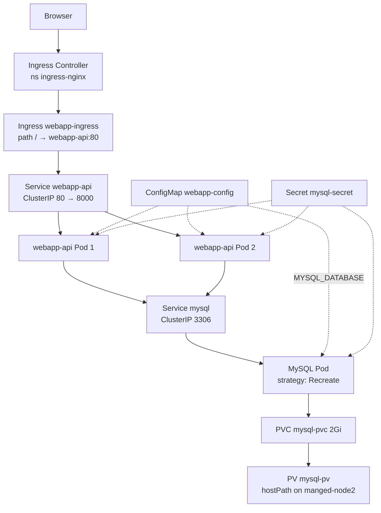

## Environment

The task is written for a 3-node minikube cluster. I ran it on a **3-node kubeadm cluster** (Kubernetes v1.30, containerd) instead:

| Node | Role | IP |
| --- | --- | --- |
| `controlnode` | control-plane (Docker for building images) | 10.0.2.1 |
| `manged-node1` | worker | 10.0.2.3 |
| `manged-node2` | worker (holds the MySQL PV) | 10.0.2.4 |

What changed compared to minikube:

| minikube step | What I did instead |
| --- | --- |
| `minikube image load` | `docker save` on the control node, then `ctr -n k8s.io images import` on each worker |
| PV pinned to `minikube-m02` | PV pinned to `manged-node2` |
| `minikube addons enable ingress` | Installed `ingress-nginx` with Helm (Option B) |
| `minikube ssh -n minikube-m02` | `ssh admin@10.0.2.4` |

## Files

| File | Content |
| --- | --- |
| `secret.yaml` | Secret `mysql-secret` (`root-password`, `app-user`, `app-password`) |
| `config.yaml` | ConfigMap `webapp-config` (5 keys) |
| `pv.yaml` | PV `mysql-pv` (hostPath, `manual`, `Retain`, nodeAffinity to `manged-node2`) |
| `pvc.yaml` | PVC `mysql-pvc` |
| `depl-mysql.yaml` | Deployment + Service `mysql` |
| `depl-webapp-api.yaml` | Deployment + Service `webapp-api` |
| `ingress.yaml` | Ingress `webapp-ingress` |

The namespace `webapp-stack` is created with `kubectl create namespace webapp-stack`.

## Steps

### 1. Build the images and load them on the workers

```bash
chmod -x mysql/initdb/01-setup.sh
docker build -t webapp-api:task2 ./webapp
docker build -t webapp-mysql:task2 ./mysql

docker save webapp-api:task2 webapp-mysql:task2 -o /tmp/task2-images.tar
for n in 10.0.2.3 10.0.2.4; do
  scp /tmp/task2-images.tar admin@$n:/tmp/
  ssh -t admin@$n "sudo ctr -n k8s.io images import /tmp/task2-images.tar"
done
```

The Deployments use `imagePullPolicy: IfNotPresent`, so the kubelet uses the local image instead of pulling from Docker Hub.

### 2. Apply the manifests in order

```bash
kubectl create namespace webapp-stack
kubectl apply -f secret.yaml
kubectl apply -f config.yaml
kubectl apply -f pv.yaml
kubectl apply -f pvc.yaml
kubectl apply -f depl-mysql.yaml        # wait until mysql is 1/1
kubectl apply -f depl-webapp-api.yaml
```

### 3. Install the Ingress Controller and create the Ingress

```bash
helm upgrade --install ingress-nginx ingress-nginx \
  --repo https://kubernetes.github.io/ingress-nginx \
  --namespace ingress-nginx --create-namespace

kubectl apply -f ingress.yaml
```

### 4. Open the app

```bash
kubectl port-forward --address 0.0.0.0 -n ingress-nginx svc/ingress-nginx-controller 8089:80
```

Port 8080 was already in use on the control node, so I used 8089. `--address 0.0.0.0` lets me open the app from my laptop's browser at `http://<control-node-ip>:8089`.

## Key design choices

- **`strategy: Recreate` for MySQL.** The old Pod stops before the new one starts, so two MySQL servers never write to the same data folder. The cost is a few seconds of downtime during a restart (see screenshot 11).
- **`nodeAffinity` on the PV.** A `hostPath` folder exists on one node only. Pinning the PV to `manged-node2` forces every MySQL Pod onto that node, so it always finds its data.
- **`persistentVolumeReclaimPolicy: Retain`.** Deleting the PVC keeps the data on disk.
- **`envFrom` for the app.** The ConfigMap keys have the same names as the app variables, so one `envFrom` passes all five. `MYSQL_PORT` in the ConfigMap also overrides the `MYSQL_PORT=tcp://...` variable Kubernetes adds for the `mysql` Service.
- **`startupProbe` for MySQL.** The first start creates the database and can be slow. The startup probe gives it up to 5 minutes before the liveness probe can kill it.

## Verification

| # | Check | Expected | Screenshot |
| --- | --- | --- | --- |
| 1 | Images on the workers | `webapp-api:task2`, `webapp-mysql:task2` | [01](Screenshots/01-images-on-worker.jpg) |
| 2 | Secret and ConfigMap | DATA 3 and 5 | [02](Screenshots/02-config-secret-pv-pvc-deploy.jpg) |
| 3 | PV and PVC | Bound, 2Gi | [02](Screenshots/02-config-secret-pv-pvc-deploy.jpg) |
| 4 | Deployments ready | mysql 1/1, webapp-api 2/2 | [02](Screenshots/02-config-secret-pv-pvc-deploy.jpg), [03](Screenshots/03-pods-rollout.jpg) |
| 5 | MySQL on the PV node | NODE `manged-node2` | [02](Screenshots/02-config-secret-pv-pvc-deploy.jpg) |
| 6 | App env | `APP_TITLE`, `MYSQL_HOST=mysql`, `MYSQL_USER`, `MYSQL_PASSWORD` | [04](Screenshots/04-app-env.jpg) |
| 7 | App Service endpoints | 2 IPs on port 8000 | [05](Screenshots/05-webapp-endpoints.jpg) |
| 8 | Default data | 2 default messages | [06](Screenshots/06-default-messages.jpg) |
| 9 | Ingress | Controller running, CLASS nginx | [07](Screenshots/07-ingress-controller-and-ingress.jpg) |
| 10 | App in the browser | Title from ConfigMap, version task2, env dev | [08](Screenshots/08-port-forward.png), [09](Screenshots/09-app-in-browser.jpg) |
| 11 | Write and read messages | My message + the 2 default ones | [09](Screenshots/09-app-in-browser.jpg), [10](Screenshots/10-api-messages-curl.jpg) |
| 12 | Data survives a MySQL restart | My message is still there | [11](Screenshots/11-mysql-restart-downtime.jpg), [12](Screenshots/12-data-after-restart.jpg) |

### 1. Images on the workers

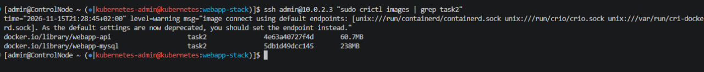

### 2. ConfigMap, Secret, PVC, PV, Deployments and the MySQL node

ConfigMap has 5 keys, Secret has 3, the PVC and PV are `Bound` with `2Gi` and class `manual`, both Deployments are ready, and MySQL runs on `manged-node2`.

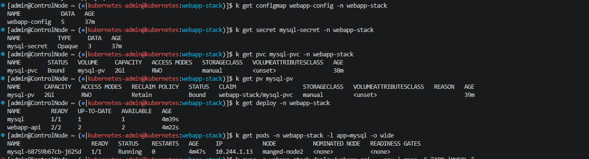

### 3. Pods after the app rollout

The two `webapp-api` Pods run on different nodes.

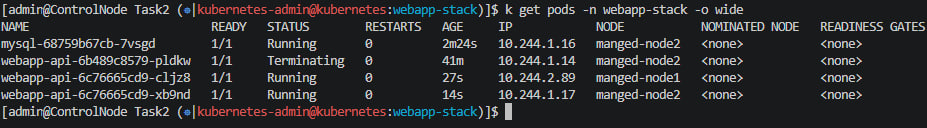

### 4. App environment variables

All ConfigMap keys arrive through `envFrom`, and `MYSQL_USER` / `MYSQL_PASSWORD` come from the Secret.

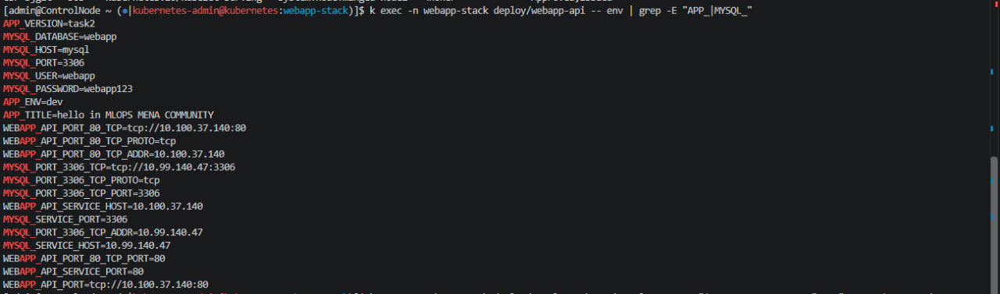

### 5. App Service endpoints

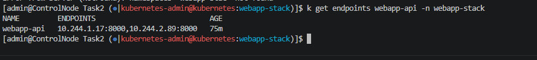

### 6. Default data created on the first MySQL start

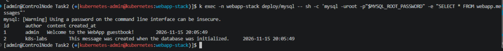

### 7. Ingress Controller, Ingress and IngressClass

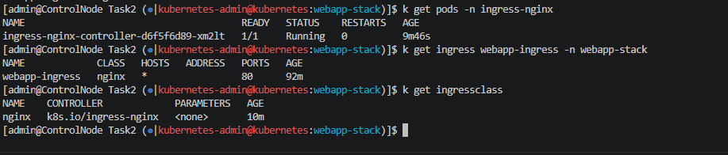

The `ADDRESS` column of the Ingress stays empty on this cluster. The controller's Service is of type `LoadBalancer`, and a bare-metal kubeadm cluster has no cloud provider or MetalLB to assign it an external IP. Traffic still reaches the controller through `port-forward`.

### 8. Port-forward to the Ingress Controller


### 9. The app in the browser, with a new message

The title and environment come from the ConfigMap, and the page shows which app Pod and which MySQL Pod served the request.

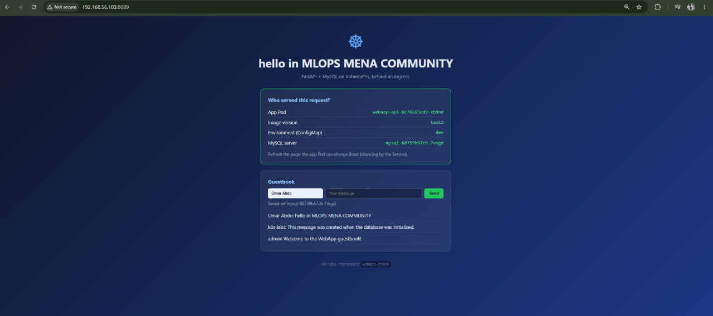

### 10. Read messages through the API

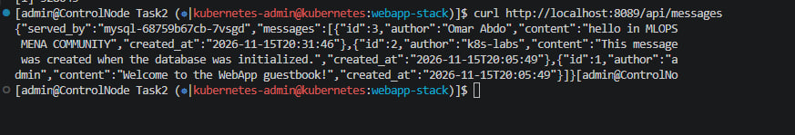

### 11. During the MySQL restart

Right after `kubectl delete pod -l app=mysql`, the app reports `Connection refused`. This is expected with `strategy: Recreate`: the old Pod is gone and the new one is still starting.

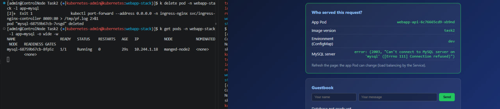

### 12. After the MySQL restart

The new MySQL Pod (`mysql-68759b67cb-8fp5z`) runs on `manged-node2`, and my message is still there because the data lives on the PV. The app Pod also changed (`...cljz8` instead of `...xb9nd`), which shows the Service load balancing between the 2 replicas.

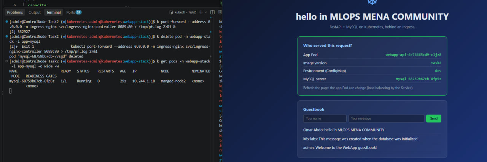

## Problems I hit and how I fixed them

| Problem | Cause | Fix |
| --- | --- | --- |
| `ErrImagePull` / `ImagePullBackOff` for `webapp-api:task2` | The images were built in Docker on the control node; the workers' containerd could not see them, so the kubelet tried Docker Hub | `docker save` + `ctr -n k8s.io images import` on every worker |
| MySQL crash loop: `data files are corrupt` | An earlier first start was interrupted, leaving a half-created data folder | Deleted the Deployment, emptied `/data/webapp-mysql` on the PV node, applied again; added a `startupProbe` so the first start is not killed |
| `Unknown database 'webapp'` | `01-setup.sh` was still executable inside the image, so the MySQL entrypoint ran it instead of sourcing it | `chmod -x mysql/initdb/01-setup.sh`, rebuilt and re-imported the image, emptied the data folder |
| `kubectl exec` failed: `x509: certificate ... doesn't contain any IP SANs` | The kubelets used self-signed serving certificates without their IP | Set `serverTLSBootstrap: true` in `/var/lib/kubelet/config.yaml` on each worker, restarted the kubelet, approved the `kubelet-serving` CSRs |
| `port-forward` on 8080 failed: `address already in use` | Another service on the control node uses 8080 | Used port 8089 |
